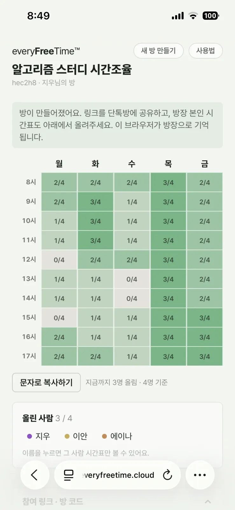
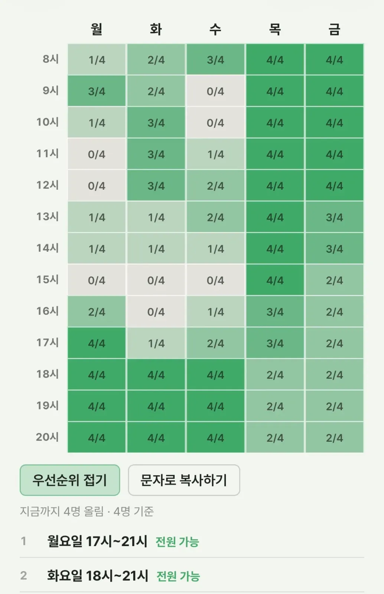
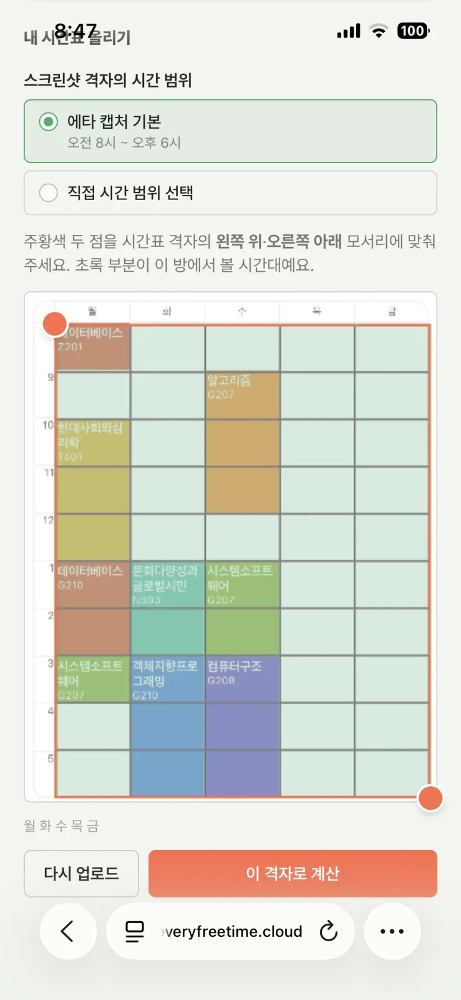
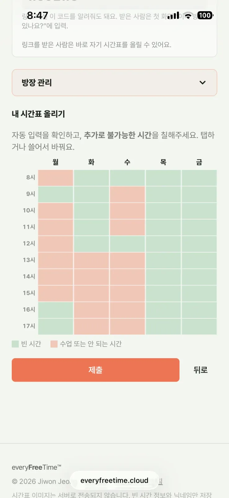

<div align="center">


# 에브리프리타임 (gaptime)

**에타 시간표 캡처만 올리면, 모두가 비는 시간을 찾아줍니다.**


🔥 **에브리타임 HOT 게시물 등재**

[**서비스 바로가기 →**](https://www.everyfreetime.cloud)






</div>

여러 명이 각자 자기 기기에서 에타 시간표 스크린샷을 올리면, 방(room) 링크 하나로 실시간 취합되어 가능 인원 수 히트맵을 보여주는 웹 서비스입니다.

## 어떻게 동작하나요

- **OCR 없이 채도만 봅니다.** 에타 시간표는 빈 시간이 무채색, 수업이 유채색이라 픽셀의 채도(saturation)만으로 칸이 비었는지 판별합니다. 과목 색상·라이트/다크 모드·기기 차이에 강하고, 브라우저에서 즉시 처리됩니다.
- **반자동 캘리브레이션.** 두 점을 끌어 격자 모서리를 맞추면, 셀 안쪽을 샘플링한 절사평균으로 글자·테두리 픽셀에 흔들리지 않게 판정합니다.
- **실시간 취합.** Supabase Realtime으로 방에 들어온 사람의 시간표가 바로 히트맵에 반영됩니다.
- **로그인 없음.** 링크가 곧 접근 권한이고, 쓰기는 SECURITY DEFINER RPC로만 허용합니다.

배경과 원칙은 [CLAUDE.md](./CLAUDE.md), 확정 상세 설계(신원·방장 관리·수동 편집 등)는 [DESIGN.md](./DESIGN.md)에 있습니다.

## 개발

```bash
pnpm install
cp .env.example .env   # Supabase URL / anon key 입력
pnpm dev
```

## Supabase 준비

`supabase/schema.sql`을 Supabase SQL Editor에서 실행하면 테이블(`rooms`, `submissions`,
`submission_editors`, `room_secrets`), RLS 정책, 관리 RPC, Realtime publication이 만들어집니다.
스키마를 고치면 SQL Editor에서 다시 실행하세요 (`create ... if not exists` / `create or replace`라
재실행 안전, 단 컬럼 추가는 수동 `alter table` 필요).

## 배포

- Vercel 정적 호스팅 (`vercel.json`에 SPA rewrite 포함)
- 환경변수 `VITE_SUPABASE_URL`, `VITE_SUPABASE_ANON_KEY` 설정

## 프라이버시

원본 스크린샷은 브라우저를 벗어나지 않습니다. 캘리브레이션과 채도 분석은 100%
클라이언트에서 처리하고, 서버로는 occupancy 배열(요일×시간 boolean)과 이름만 전송됩니다.

## 구조

- `src/lib/colorAnalysis.ts` — RGB→HSV, saturation 판별
- `src/lib/gridSampler.ts` — bounding box → 셀 분할 → occupancy 배열
- `src/lib/overlap.ts` — 여러 occupancy를 셀별 가능 인원 수로 결합
- `src/lib/supabase.ts` — 방/제출 CRUD + Realtime 구독
- `src/components/GridCalibrator.tsx` — 2점 드래그 캘리브레이션
- `src/components/ResultGrid.tsx` — When2meet 스타일 히트맵 + hover + export
